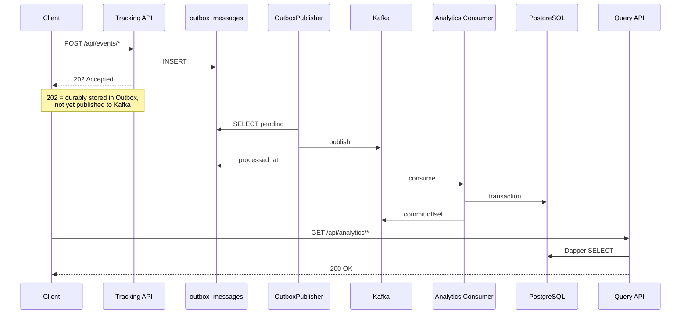
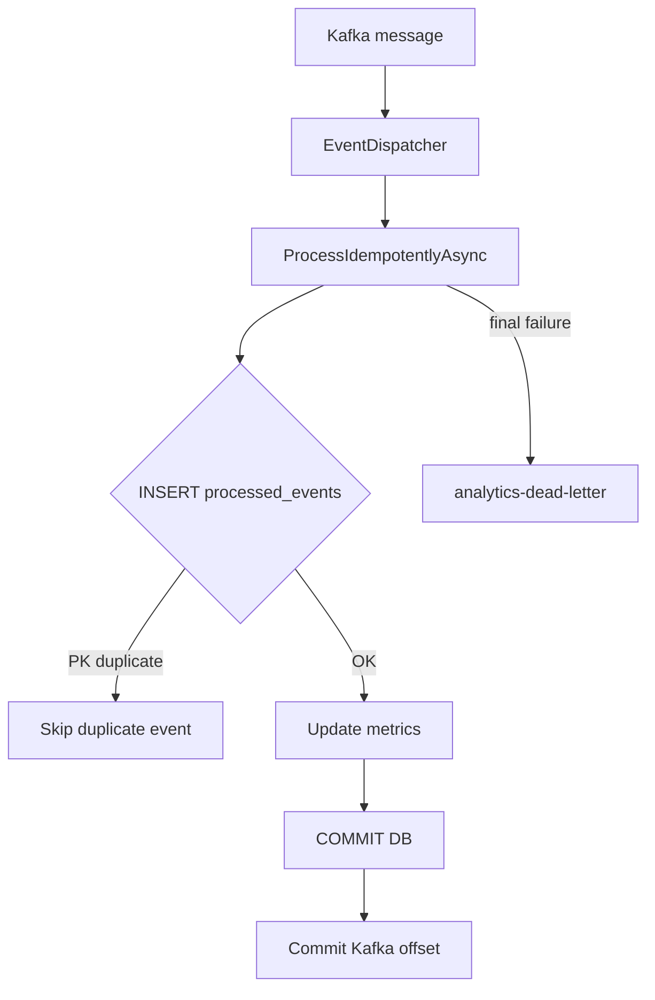

# EventStreaming.Analytics.Kafka

[](https://github.com/luismpenholato/EventStreaming.Analytics.Kafka/actions/workflows/ci.yml)
[](https://dotnet.microsoft.com/)
[](LICENSE)
[](https://github.com/sponsors/luismpenholato)

Turn e-commerce activity events into queryable metrics with durable HTTP ingestion, Kafka consumers and PostgreSQL read models.

**Study / portfolio reference** — not a production analytics product.

**Stack:** .NET 10 · Apache Kafka · PostgreSQL · EF Core / Dapper · Docker Compose · xUnit / Testcontainers.

[Quick start](#running-with-docker-compose) · [What you'll learn](#what-youll-learn) · [Portfolio series](#portfolio-series) · [Event flow](#event-flow) · [Try the API](#validating-the-flow) · [Tests](#build-and-tests)

## Purpose

This repository is a **portfolio / reference project** for behavioral analytics in an e-commerce scenario. It demonstrates how to:

- Ingest HTTP events durably and asynchronously
- Publish to Kafka through an Outbox Pattern
- Process streams with consumer groups and transactional idempotency
- Materialize metrics for fast reads
- Separate write and read paths with light CQRS

It is **not** a production-ready product. It intentionally keeps operational complexity low while exposing patterns commonly used in real distributed systems.

## What you'll learn

- Durable HTTP ingestion with `202 Accepted`
- Outbox → Kafka publishing without losing events
- Consumer-group processing with idempotent materialization
- CQRS-style read models queried with Dapper
- Local Docker Compose for Kafka + PostgreSQL

## Portfolio series

| Repository | Focus |
| ---------- | ----- |
| [Microservices.Ecommerce](https://github.com/luismpenholato/Microservices.Ecommerce) | Microservices e-commerce + gateway + observability |
| [EventDriven.OrderProcessing.RabbitMQ](https://github.com/luismpenholato/EventDriven.OrderProcessing.RabbitMQ) | Order flow with RabbitMQ / MassTransit workers |
| **This repo** | Kafka analytics pipeline + CQRS read models |
| [orderflow-operations](https://github.com/luismpenholato/orderflow-operations) | Node/React modular monolith (inventory + ERP outbox) |
| [clean-stack](https://github.com/luismpenholato/clean-stack) | Full-stack starter (.NET 10 + Angular / React) |

## Architecture overview

The system follows an event-driven pipeline:

**HTTP ingestion → PostgreSQL outbox → Kafka → analytics consumer → PostgreSQL metrics → Dapper read API**

Kafka provides the event log and streaming backbone. PostgreSQL stores the outbox, processed-event ledger, and materialized metrics.

See also: [docs/architecture.md](docs/architecture.md)

## Runtime components

| Component                 | Docker port              | Role                                                                                             |
| ------------------------- | ------------------------ | ------------------------------------------------------------------------------------------------ |
| **Tracking API**          | 5001                     | Write-facing HTTP ingestion; validates and persists to `outbox_messages`; returns `202 Accepted` |
| **OutboxPublisherWorker** | (hosted in Tracking API) | Background worker that publishes pending outbox rows to Kafka                                    |
| **Analytics Consumer**    | —                        | Consumer group member; materializes metrics transactionally                                      |
| **Query API**             | 5002                     | Read-facing API backed by Dapper                                                                 |
| **PostgreSQL**            | 5432                     | Outbox, `processed_events`, and metrics tables                                                   |
| **Kafka**                 | 9092                     | Event streaming backbone                                                                         |

## Event flow



## Outbox Pattern

The Tracking API does **not** publish to Kafka inside the HTTP request. Instead:

1. The event is validated and inserted into `outbox_messages`.
2. The API returns `202 Accepted` after the PostgreSQL commit.
3. `OutboxPublisherWorker` polls every ~2 seconds and delegates to `IOutboxPublisher`.
4. Successful publishes update `processed_at`; failures increment `retry_count`.

This keeps ingestion durable even when Kafka is temporarily unavailable.

Details: [docs/decisions/0004-outbox-pattern.md](docs/decisions/0004-outbox-pattern.md)

## Consumer idempotency

Kafka delivery is at-least-once. The Analytics Consumer uses **transactional idempotency**:



## Production-like decisions

| Decision                  | Implementation                                                |
| ------------------------- | ------------------------------------------------------------- |
| Durable ingestion         | `outbox_messages` before Kafka publish                        |
| Async publish             | `OutboxPublisherWorker` + `IOutboxPublisher`                  |
| `202 Accepted` semantics  | Response after PostgreSQL commit, not after Kafka publish     |
| Transactional idempotency | `processed_events` + single DB transaction                    |
| Failure handling          | Retry policy + `analytics-dead-letter` dead-letter topic      |
| Light CQRS                | Write path (Consumer / EF Core) vs read path (Query / Dapper) |
| Fast reads                | Query API using Dapper                                        |
| Observability             | Serilog + `X-Correlation-Id` header                           |
| Kafka abstraction         | `IIntegrationEventPublisher` in Contracts                     |
| Event routing             | `IntegrationEventRegistry`                                    |
| Manual offset commit      | Commit only after successful transaction                      |
| Consumer groups           | `analytics-consumer-group`                                    |

Architecture Decision Records: [docs/decisions/](docs/decisions/)

## What does 202 Accepted mean?

`202 Accepted` means the event was **validated and durably stored in `outbox_messages`**. It does **not** guarantee the message is already on Kafka.

Publication happens asynchronously through `OutboxPublisherWorker`. If you query the Query API immediately after a POST, metrics may not exist yet — wait a few seconds for outbox → Kafka → consumer processing.

## Why Kafka?

This project uses partitioned topics, consumer groups and explicit offset commits to demonstrate streaming analytics. The focus is the event log and its consumers, rather than order-processing choreography.

Replay must account for the application's idempotency ledger: resetting Kafka offsets alone does not rebuild metrics for events already recorded in `processed_events`. Plan a separate read-model rebuild strategy before using replay operationally.

For a complementary choreography example, see [EventDriven.OrderProcessing.RabbitMQ](https://github.com/luismpenholato/EventDriven.OrderProcessing.RabbitMQ).

## Repository structure

```
src/
  BuildingBlocks/          # Shared contracts, Kafka, observability
  Services/
    Tracking/                # Api, Application, Infrastructure
    Analytics/               # Consumer, Application, Domain, Infrastructure
    Query/                     # QueryApi, QueryApplication, QueryInfrastructure
tests/
  Tracking.UnitTests
  Analytics.UnitTests
  Tracking.IntegrationTests
  Analytics.IntegrationTests
  Query.IntegrationTests
docs/
  architecture.md
  kafka-topics.md
  streaming-flow.md
  requests/event-streaming.http
  decisions/
docker-compose.yml
EventStreaming.Analytics.Kafka.slnx
```

## Endpoints

Sample requests: [docs/requests/event-streaming.http](docs/requests/event-streaming.http)

Optional header on all requests: `X-Correlation-Id: <guid>`

### Tracking API — http://localhost:5001

| Method | Route                               |
| ------ | ----------------------------------- |
| POST   | `/api/events/product-viewed`        |
| POST   | `/api/events/product-added-to-cart` |
| POST   | `/api/events/checkout-started`      |
| POST   | `/api/events/order-completed`       |
| POST   | `/api/events/user-logged-in`        |
| GET    | `/health`                           |

### Query API — http://localhost:5002

| Method | Route                                 |
| ------ | ------------------------------------- |
| GET    | `/api/analytics/products/{productId}` |
| GET    | `/api/analytics/summary`              |
| GET    | `/api/analytics/events-by-type`       |
| GET    | `/api/analytics/conversion-rate`      |
| GET    | `/health`                             |

## Running with Docker Compose

### Prerequisites

- Docker Desktop or Docker Engine + Compose v2
- Free ports: `5001`, `5002`, `5432`, `9092`

### Start the stack

```bash
git clone https://github.com/luismpenholato/EventStreaming.Analytics.Kafka.git
cd EventStreaming.Analytics.Kafka
docker compose up --build
```

On first run, wait for `kafka-init` to create topics and for the APIs to become healthy. This command stays attached to the logs; open another terminal for the HTTP examples.

| Service      | URL / host                                                                         |
| ------------ | ---------------------------------------------------------------------------------- |
| Tracking API | http://localhost:5001                                                              |
| Query API    | http://localhost:5002                                                              |
| Kafka (host) | localhost:9092                                                                     |
| PostgreSQL   | localhost:5432 — database `analytics`, user/password `analytics` (local demo only) |

The `kafka-init` service waits for Kafka readiness and creates:

- `user-activity-events` (3 partitions)
- `order-events` (3 partitions)
- `analytics-dead-letter` (1 partition)

PostgreSQL includes a health check. Application services wait for dependencies before starting.

### Stop and clean up

```bash
docker compose down
```

This preserves stored data. For a disposable local environment only, `docker compose down -v` also deletes Compose volumes, including PostgreSQL data. Back up anything you need before using it.

## Validating the flow

```bash
curl -X POST http://localhost:5001/api/events/product-viewed \
  -H "Content-Type: application/json" \
  -H "X-Correlation-Id: 11111111-1111-1111-1111-111111111111" \
  -d "{\"userId\":\"user-1\",\"productId\":\"prod-42\"}"

# Wait 3–5 seconds for outbox → Kafka → consumer

curl http://localhost:5002/api/analytics/products/prod-42
curl http://localhost:5002/api/analytics/summary
curl http://localhost:5001/health
curl http://localhost:5002/health
```

Alternative: open [docs/requests/event-streaming.http](docs/requests/event-streaming.http) in VS Code or Rider (REST Client extension).

## Build and tests

Requires .NET 10 SDK.

```bash
dotnet restore
dotnet build
dotnet test
```

| Test project                       | Type                                                             | Docker required |
| ---------------------------------- | ---------------------------------------------------------------- | --------------- |
| `tests/Tracking.UnitTests`         | Unit                                                             | No              |
| `tests/Analytics.UnitTests`        | Unit                                                             | No              |
| `tests/Tracking.IntegrationTests`  | Integration (Testcontainers: PostgreSQL + WebApplicationFactory) | Yes             |
| `tests/Analytics.IntegrationTests` | Integration (Testcontainers)                                     | Yes             |
| `tests/Query.IntegrationTests`     | Integration (Testcontainers)                                     | Yes             |

Integration tests spin up **PostgreSQL via Testcontainers**. They do **not** currently use a Kafka Testcontainer. Docker must be running for integration tests to pass.

Run subsets:

```bash
dotnet test tests/Tracking.UnitTests
dotnet test tests/Analytics.UnitTests
dotnet test tests/Tracking.IntegrationTests
dotnet test tests/Analytics.IntegrationTests
dotnet test tests/Query.IntegrationTests
```

## Conscious trade-offs

Technologies **not used** in this portfolio:

| Not used                | Reason                                                             |
| ----------------------- | ------------------------------------------------------------------ |
| **MassTransit**         | Native `Confluent.Kafka` client to expose Kafka concepts directly  |
| **MediatR**             | Explicit handlers and simple DI boundaries                         |
| **Redis**               | PostgreSQL is enough for the demo scope                            |
| **Kubernetes**          | Docker Compose keeps local execution simple                        |
| **Debezium CDC**        | Worker-based outbox is easier to understand in a portfolio project |
| **Full CQRS framework** | Explicit handlers and simple boundaries are enough for this scope  |
| **RabbitMQ**            | Kafka fits streaming analytics and replayable logs better          |

Key costs:

| Decision                   | Benefit                                  | Cost                                 |
| -------------------------- | ---------------------------------------- | ------------------------------------ |
| Outbox Pattern             | Durable ingestion                        | Eventual consistency                 |
| Dapper for Query API       | Fast and explicit reads                  | Separate read model maintenance      |
| Event Registry             | Single registration point per event type | Rebuild when adding new event types  |
| Single PostgreSQL database | Easier local setup                       | Shared operational boundary          |
| Manual Kafka commit        | Safer processing                         | More responsibility in consumer code |

## Stack

.NET 10 · ASP.NET Core · Apache Kafka · PostgreSQL · EF Core · Dapper · FluentValidation · xUnit · FluentAssertions · Serilog · Testcontainers · Docker Compose

## Documentation

| Document                                                                 | Description                        |
| ------------------------------------------------------------------------ | ---------------------------------- |
| [docs/architecture.md](docs/architecture.md)                             | Architecture overview and diagrams |
| [docs/streaming-flow.md](docs/streaming-flow.md)                         | Step-by-step event flow            |
| [docs/kafka-topics.md](docs/kafka-topics.md)                             | Topic layout and consumer group    |
| [docs/requests/event-streaming.http](docs/requests/event-streaming.http) | HTTP request samples               |
| [docs/decisions/](docs/decisions/)                                       | Architecture Decision Records      |
| [CONTRIBUTING.md](CONTRIBUTING.md)                                       | How to contribute                  |
| [SECURITY.md](SECURITY.md)                                               | Security policy (demo scope)       |
| [CODE_OF_CONDUCT.md](CODE_OF_CONDUCT.md)                                 | Community standards                |
| [CHANGELOG.md](CHANGELOG.md)                                             | Notable project changes            |

## License

MIT — educational / portfolio project. See [LICENSE](LICENSE).

Optional support for open-source maintenance: [GitHub Sponsors](https://github.com/sponsors/luismpenholato).
