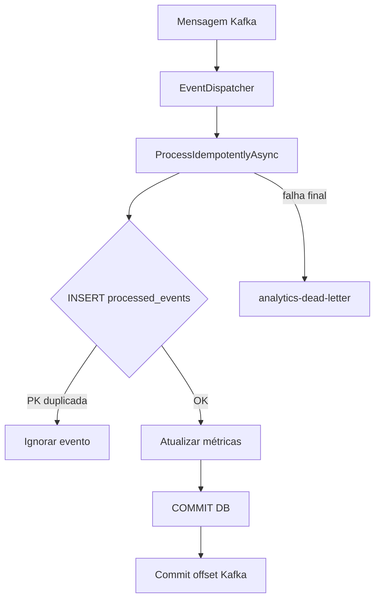

# EventStreaming.Analytics.Kafka

Portfólio sênior de **event streaming** com .NET 10, Apache Kafka, PostgreSQL e decisões próximas de produção: **Outbox Pattern**, idempotência transacional, CQRS light, Dapper na leitura e observabilidade com `CorrelationId`.

## Objetivo

Simular uma plataforma de analytics de comportamento (e-commerce) que:

- Ingere alto volume de eventos de forma resiliente
- Processa em background com consumer groups
- Materializa métricas para consulta rápida
- Separa claramente **escrita no stream** vs **leitura de métricas**

## Arquitetura

Quatro componentes em runtime:

| Componente | Porta (Docker) | Papel |
|------------|----------------|-------|
| **Tracking API** | 5001 | Valida HTTP → persiste **Outbox** → `202 Accepted` |
| **OutboxPublisherWorker** | (dentro da Tracking API) | Publica pendências no Kafka |
| **Analytics Consumer** | — | Consome Kafka → agrega métricas (transação) |
| **Query API** | 5002 | Consulta métricas via **Dapper** |

### Fluxo com Outbox


### Idempotência do consumer



Mais detalhes: [docs/architecture.md](docs/architecture.md)

## Production-like decisions

| Decisão | Implementação |
|---------|----------------|
| **Outbox na ingestão** | `outbox_messages` + `IOutboxPublisher` |
| **202 ≠ Kafka imediato** | Resposta após commit no PostgreSQL |
| **Idempotência** | `processed_events` + transação única |
| **DLQ** | `analytics-dead-letter` após retries |
| **CQRS light** | Write (Consumer/EF) vs Read (Query/Dapper) |
| **Event Registry** | `IntegrationEventRegistry` |
| **Abstração de mensageria** | `IIntegrationEventPublisher` em Contracts |
| **CorrelationId** | Header `X-Correlation-Id` + Serilog |
| **Consumer group** | `analytics-consumer-group`, commit manual |

ADRs: [docs/decisions/](docs/decisions/)

## O que significa 202 Accepted?

`202 Accepted` significa que o evento foi **validado e gravado em `outbox_messages`**. A publicação no Kafka ocorre depois, de forma assíncrona, pelo `OutboxPublisherWorker`.

Ao consultar a Query API logo após o POST, as métricas podem ainda não existir — aguarde alguns segundos (outbox → Kafka → consumer).

## Kafka vs RabbitMQ

| | Kafka | RabbitMQ |
|---|-------|----------|
| Modelo | Log imutável, replay | Fila com remoção após ack |
| Consumidores | Consumer groups independentes | Competing consumers |
| Uso neste projeto | Stream de analytics | Não adotado |

## Estrutura do repositório

```
src/
  BuildingBlocks/
  Services/
    Tracking/       # Api, Application, Infrastructure
    Analytics/      # Consumer, Application, Domain, Infrastructure
    Query/          # QueryApi, QueryApplication, QueryInfrastructure
tests/
docs/
  architecture.md
  kafka-topics.md
  streaming-flow.md
  requests/event-streaming.http
  decisions/
docker-compose.yml
```

## Endpoints

Exemplos prontos: [docs/requests/event-streaming.http](docs/requests/event-streaming.http)

### Tracking API — http://localhost:5001

| Método | Rota |
|--------|------|
| POST | `/api/events/product-viewed` |
| POST | `/api/events/product-added-to-cart` |
| POST | `/api/events/checkout-started` |
| POST | `/api/events/order-completed` |
| POST | `/api/events/user-logged-in` |

### Query API — http://localhost:5002

| Método | Rota |
|--------|------|
| GET | `/api/analytics/products/{productId}` |
| GET | `/api/analytics/summary` |
| GET | `/api/analytics/events-by-type` |
| GET | `/api/analytics/conversion-rate` |

Header opcional: `X-Correlation-Id: <guid>`

## Como rodar com Docker Compose

### Pré-requisitos

- Docker Desktop (ou Docker Engine + Compose v2)
- Portas livres: `5001`, `5002`, `5432`, `9092`

### Subir a stack

```bash
docker compose up --build
```

Na primeira execução, aguarde o `kafka-init` concluir e as APIs ficarem healthy.

| Serviço | URL / host |
|---------|------------|
| Tracking API | http://localhost:5001 |
| Query API | http://localhost:5002 |
| Kafka (host) | localhost:9092 |
| PostgreSQL | localhost:5432 — db `analytics`, user/pass `analytics` |

### Validar o fluxo

```bash
curl -X POST http://localhost:5001/api/events/product-viewed \
  -H "Content-Type: application/json" \
  -H "X-Correlation-Id: 11111111-1111-1111-1111-111111111111" \
  -d "{\"userId\":\"user-1\",\"productId\":\"prod-42\"}"

# Aguarde 3–5 segundos

curl http://localhost:5002/api/analytics/products/prod-42
curl http://localhost:5002/api/analytics/summary
curl http://localhost:5001/health
curl http://localhost:5002/health
```

Alternativa: abrir `docs/requests/event-streaming.http` no VS Code ou Rider (REST Client).

### Parar e limpar

```bash
docker compose down
docker compose down -v   # remove volume do PostgreSQL
```

## Build e testes (local, sem Compose)

Requer .NET 10 SDK. Testes de integração usam Testcontainers e precisam de Docker em execução.

```bash
dotnet build
dotnet test

# Apenas unitários
dotnet test tests/Tracking.UnitTests
dotnet test tests/Analytics.UnitTests

# Integração (Testcontainers)
dotnet test tests/Tracking.IntegrationTests
dotnet test tests/Analytics.IntegrationTests
dotnet test tests/Query.IntegrationTests
```

## Trade-offs conscientes

Tecnologias **não adotadas** neste portfólio:

| Não usado | Motivo |
|-----------|--------|
| **MassTransit** | Kafka nativo com `Confluent.Kafka` |
| **MediatR** | Handlers explícitos + DI |
| **Redis** | PostgreSQL suficiente para o escopo |
| **Kubernetes** | Docker Compose para demo local |
| **GitHub Actions / CI** | Validação manual/local |
| **Debezium CDC** | Outbox com worker mais didático |

| Decisão | Benefício | Custo |
|---------|-----------|-------|
| Outbox | Durabilidade na ingestão | Latência eventual |
| Dapper na Query | Leitura desacoplada | Sem read model versionado |
| Event Registry | Um ponto por evento | Rebuild ao adicionar tipo |
| PostgreSQL único | Operação simples | Tabelas compartilhadas no mesmo DB |

## Stack

.NET 10 · ASP.NET Core · Kafka · PostgreSQL · EF Core · Dapper · FluentValidation · xUnit · FluentAssertions · Serilog · Docker Compose

## Licença

MIT — projeto educacional / portfólio.
