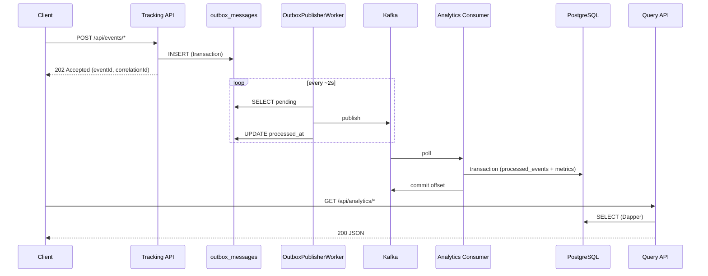
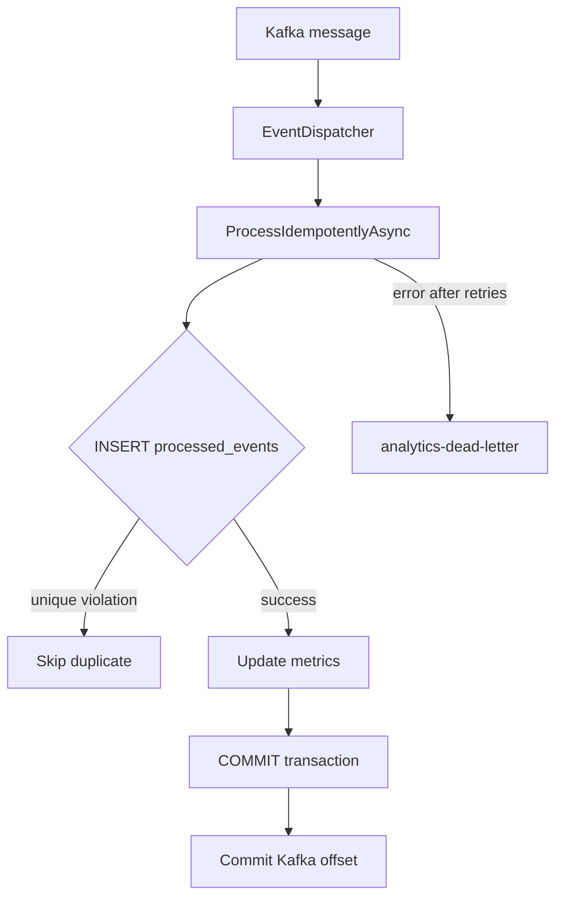

# Architecture — EventStreaming.Analytics.Kafka

## Overview

Event streaming analytics platform that simulates user-behavior tracking in an e-commerce scenario. The system separates ingestion, relay, processing, and querying with production-like patterns:

| Layer | Service | Responsibility |
|-------|---------|----------------|
| Ingestion | `Tracking.Api` | Receive HTTP events, validate, persist to **Outbox** |
| Relay | `OutboxPublisherWorker` | Publish pending outbox rows to Kafka via `IOutboxPublisher` |
| Processing | `Analytics.Consumer` | Consume stream, aggregate metrics, transactional idempotency |
| Query | `Analytics.QueryApi` | Expose metrics via **Dapper** (read-only) |

## Outbox flow



## Consumer idempotency



## Bounded contexts

- **Tracking**: validation, outbox, async publication.
- **Analytics**: stream processing, aggregation, `processed_events` ledger.
- **Query**: SQL reads via Dapper, no dependency on the write stack.

## Building blocks

| Project | Contents |
|---------|----------|
| `BuildingBlocks.Contracts` | Events, `IIntegrationEventPublisher`, `IntegrationEventRegistry` |
| `BuildingBlocks.Kafka` | Producer, consumer base, retry, DLQ |
| `BuildingBlocks.Domain` | `Result<T>` |
| `BuildingBlocks.Observability` | Serilog, `CorrelationIdMiddleware` |

## Local execution

```bash
docker compose up --build
```

| Service | URL |
|---------|-----|
| Tracking API | http://localhost:5001 |
| Query API | http://localhost:5002 |

Sample requests: [requests/event-streaming.http](requests/event-streaming.http)

## Decisions

See [decisions/](decisions/) for numbered ADRs.
