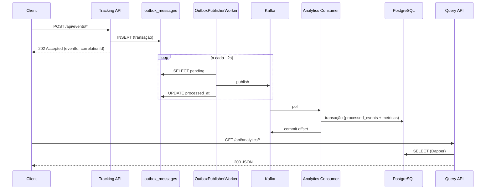
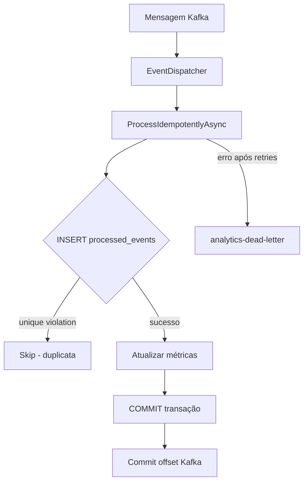

# Arquitetura — EventStreaming.Analytics.Kafka

## Visão geral

Plataforma de analytics baseada em **event streaming** que simula rastreamento de comportamento do usuário em um e-commerce. O sistema separa três responsabilidades com decisões próximas de produção:

| Camada | Serviço | Responsabilidade |
|--------|---------|------------------|
| Ingestão | `Tracking.Api` | Receber eventos HTTP, validar, persistir no **Outbox** |
| Relay | `OutboxPublisherWorker` | Publicar outbox pendente no Kafka (`IOutboxPublisher`) |
| Processamento | `Analytics.Consumer` | Consumir stream, agregar métricas, idempotência |
| Consulta | `Analytics.QueryApi` | Expor métricas via **Dapper** (somente leitura) |

## Fluxo com Outbox



## Idempotência do consumer



## Bounded contexts

- **Tracking**: validação, outbox, publicação assíncrona.
- **Analytics**: processamento, agregação, `processed_events`.
- **Query**: leitura SQL via Dapper, sem dependência de write stack.

## Building blocks

| Projeto | Conteúdo |
|---------|----------|
| `BuildingBlocks.Contracts` | Eventos, `IIntegrationEventPublisher`, `IntegrationEventRegistry` |
| `BuildingBlocks.Kafka` | Producer, consumer base, retry, DLQ |
| `BuildingBlocks.Domain` | `Result<T>` |
| `BuildingBlocks.Observability` | Serilog, `CorrelationIdMiddleware` |

## Execução local

```bash
docker compose up --build
```

| Serviço | URL |
|---------|-----|
| Tracking API | http://localhost:5001 |
| Query API | http://localhost:5002 |

Requisições de exemplo: [requests/event-streaming.http](requests/event-streaming.http)

## Decisões

Ver [decisions/](decisions/) para ADRs numerados.
